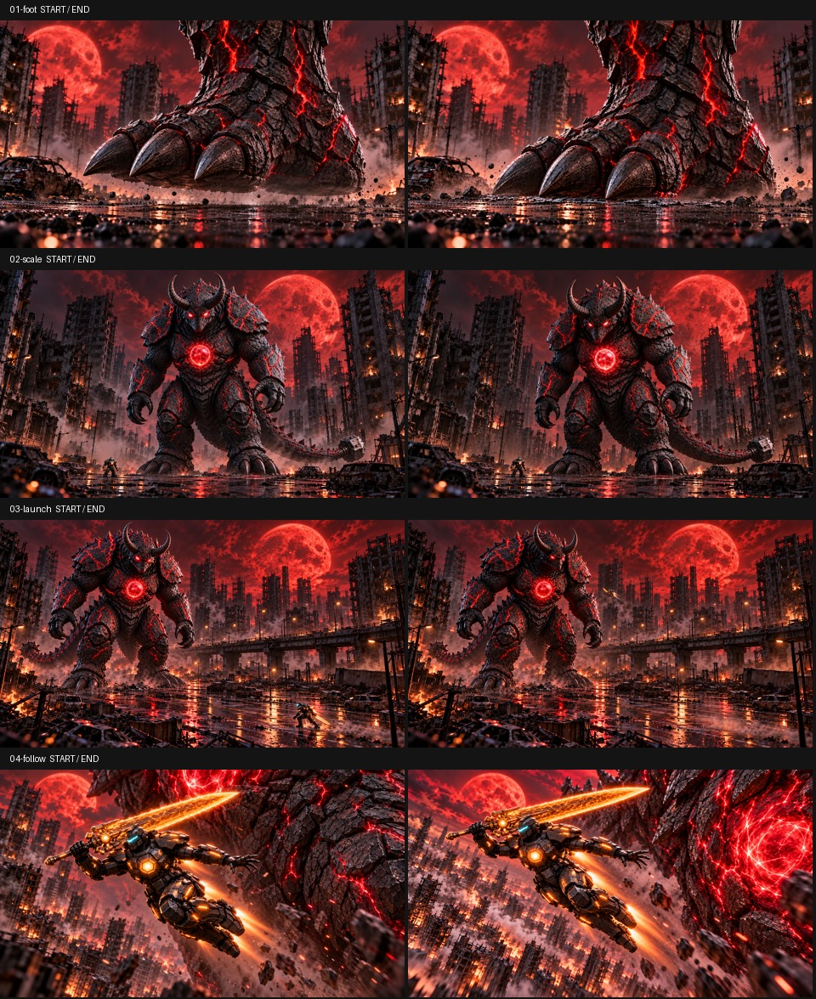

# 巨兽登场 V3：落脚接地与持刀跟拍

依据 V2 成片复查：落脚参考图的脚跟、脚底和接地关系含糊；全身展示可缩短；远景起飞中英雄过小，动作难以辨认。本版重做落脚首尾图，新增持刀飞行中景首尾图，保留全身和远景起飞图，合计四组。

这是参考图、正向提示词和工作流测试包；尚未在 H3 上渲染验证。图片已逐张检查，但 FL2V 端点约束无法保证动作速度曲线和中间帧解剖稳定性。人物尺寸变化来自景别与景深；图片不是精确三维尺度验证。

## 使用

1. 优先导入 `01-foot-workflow.json` 与 `04-follow-workflow.json`，分别测试落脚接地和侧面跟拍。
2. 在每组首尾图槽上传 `frames` 中同编号的 start/end 图片。JSON 内的文件名不等于已上传到你本机的图片；请核对槽位缩略图。
3. 整段测试使用 `ALL-4-shots-workflow.json`。四组之间直接切镜，每组内部一个连续镜头。
4. 模型使用 FL2VA；25 steps、CFG 1、res_multistep / simple、shift video 12 / audio 3、seed 888、864×480、24fps。Turbo 与 Combat LoRA 保持旁路，段间引导关闭，输出静音。
5. 界面填写下表的请求秒数，实际帧数受 Director 的 17k+5 对齐影响。以本机显示与实际输出为准。

| 组 | 内容 | 界面秒数 | 预期帧数 | 实际播放时长 |
|---|---|---:|---:|---:|
| 01-foot | 三趾巨足短促落地、脚底承重 | 2 | 56 | 2.333秒 |
| 02-scale | 巨兽全身与脚边英雄的尺度展示 | 1.3 | 39 | 1.625秒 |
| 03-launch | 持刀远景起飞 | 3 | 73 | 3.042秒 |
| 04-follow | 持刀侧前方中景跟拍 | 3 | 73 | 3.042秒 |
| 合计 | 四镜头 | 9.3 | 241 | 10.042秒 |

需要整10秒时，生成后运行 `python conform_10s.py ALL-output.mp4 --output titan-v3-10s.mp4`。脚本核对241帧/24fps后，从落脚段末部移除一帧，保持各镜头首尾图，输出240帧。这里属于时长校准，不是动作优化。

## 这次图像调整

- 01：厚实脚跟、接近水平的足底、三枚向前的趾爪。首帧脚底接近路面；尾帧下落压实，接触线清楚，尘石集中于两侧。月亮、汽车和楼房位置基本对应。
- 02：沿用 V2 全身图，缩短为约1.6秒。
- 03：沿用 V2 远景首尾图，缩短为约3秒，以连续上升动势切到中景。
- 04：新建靠近人物的跟拍图，Aegis右手持刀，左手平衡，完整身体清晰可读；巨兽胸甲作为尺度背景。首尾图表现收腿到伸腿加速，刀架在肩部上方。切镜后的持刀姿态有调整，需检查实际成片的衔接。

所有 TXT、全局提示词和组内提示词采用正向描述，负向字段为空。局部秒数是动作节奏指导，具体落点仍需实测。

## 验收重点

- 脚跟与脚底是否真正压到同一地面，三趾是否稳定。
- 尘土是否在触地后向外散开，接触线是否可见。
- 起飞是否出现清楚的离地和位移。
- 跟拍是否有人物姿态变化与背景视差，持刀手及四肢是否稳定。
- 若中景依旧偏慢，先选取有效动作区间剪接，再决定是否重跑。
